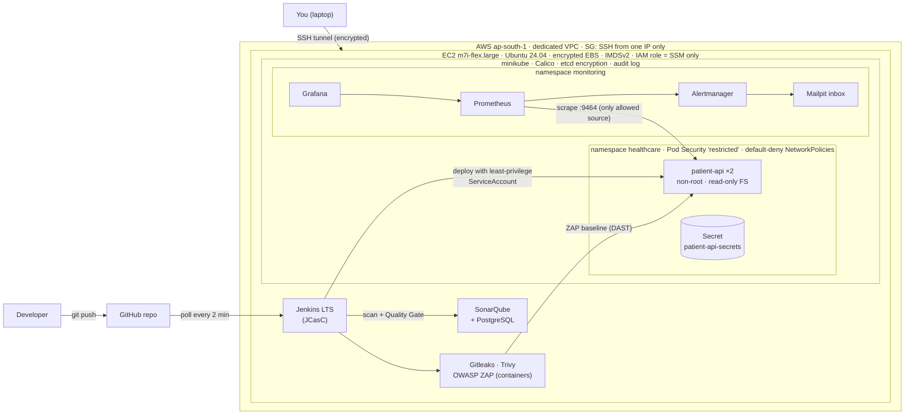

# VLE-9: Secure DevSecOps Pipeline for a Healthcare System

**MedSecure** is a small patient-records application whose Protected Health Information (PHI) is **secured, encrypted, monitored and compliance-oriented**. It is built, scanned and deployed by a Jenkins pipeline in which every stage is a security gate:

**GitHub → Jenkins → Gitleaks → Unit tests → npm audit + Trivy (deps + IaC) → SonarQube SAST + Quality Gate → Docker build → Trivy image scan → Kubernetes (RBAC, secrets) → OWASP ZAP DAST → Prometheus + Grafana + Alertmanager**

Everything runs on **one AWS EC2 instance** (`m7i-flex.large`, Free-plan eligible) created by Terraform, with Kubernetes provided by **minikube**.

> Status: deployed and verified on AWS on 2026-11-14 (two green Jenkins runs, all security alerts fired). Details and every problem found on the way: [docs/VERIFICATION.md](docs/VERIFICATION.md).

---

## Contents

1. [Architecture](#architecture)
2. [Lab steps → where they are implemented](#lab-steps--where-they-are-implemented)
3. [Security layers](#security-layers)
4. [Repository layout](#repository-layout)
5. [How to run it](#how-to-run-it)
6. [Expected output](#expected-output)
7. [Cost and cleanup](#cost-and-cleanup)
8. [Differences from the handout (and why)](#differences-from-the-handout-and-why)

---

## Architecture



A larger diagram of the pipeline gates is in [docs/ARCHITECTURE.md](docs/ARCHITECTURE.md).

## Lab steps → where they are implemented

| Handout step | Implementation | Files |
|---|---|---|
| 1. Secure infrastructure (EC2, SGs, IAM least privilege) | Terraform: dedicated VPC, SG with **only SSH from your /32**, egress 80/443 only, locked default SG, IAM role with **only** `AmazonSSMManagedInstanceCore`, IMDSv2 (hop limit 1), encrypted gp3 volume. Plus a least-privilege policy for the Terraform user itself | `infra/terraform/` |
| 2. Install DevSecOps tools | EC2 user-data bootstrap: Docker, Git, Java 21, Jenkins LTS, Trivy, kubectl, minikube, Helm (checksums verified); SonarQube and ZAP as pinned containers | `scripts/ec2/00-bootstrap.sh`, `security/sonarqube/docker-compose.yml` |
| 3. Secure coding | Input validation (allow-lists, strict schemas, no mass assignment), **no hardcoded secrets** (app refuses to start without them), env vars, scrypt password hashing, JWT (HS256 only, 15 min, revocable), RBAC per role, account lockout + rate limiting, **AES-256-GCM encryption of PHI**, audit log, security headers, 48 unit tests | `app/src/`, `app/test/` |
| 4. SAST (SonarQube) | `SAST + Quality Gate` stage; JS + Dockerfile + Kubernetes + Terraform rules; coverage from tests; non-admin `jenkins` token | `sonar-project.properties`, `scripts/ci/sonar-scan.sh` |
| 5. Secure Docker image | Multi-stage, pinned digest, Node 24 LTS on Alpine, npm/yarn removed, `apk upgrade`, non-root uid 10001, read-only app files, healthcheck | `Dockerfile`, `.dockerignore` |
| 6. Container scan (Trivy) | Gate on fixable HIGH/CRITICAL, end-of-life OS and end-of-life Node; SBOM (CycloneDX); also `trivy fs` for dependencies, secrets and IaC | `scripts/ci/trivy-image.sh`, `scripts/ci/sca-scan.sh` |
| 7. Kubernetes deploy (RBAC, Secrets) | Namespace with Pod Security `restricted`; least-privilege `jenkins-deployer` ServiceAccount; Secret built from Jenkins credentials (never in Git), encrypted in etcd; NetworkPolicies; quotas; auto-rollback | `k8s/`, `scripts/deploy.sh`, `scripts/ec2/03-start-minikube.sh` |
| 8. DAST (OWASP ZAP) | `zap-baseline.py` against the running app; rules file makes header/info-leak findings **FAIL**; failure rolls the deployment back | `scripts/ci/zap-baseline.sh`, `security/zap/rules.tsv` |
| 9. Monitoring & alerting | kube-prometheus-stack; app metrics on a separate port; alerts for **unauthorised access, failed logins/brute force, high CPU**, privilege abuse, bulk PHI access, downtime; Grafana dashboard; email alerts to a Mailpit inbox | `monitoring/` |
| 10. CI/CD secure pipeline | Declarative `Jenkinsfile` with 9 gated stages; Jenkins configured as code | `Jenkinsfile`, `jenkins/`, `scripts/ec2/05-configure-jenkins.sh` |

## Security layers

| Layer (handout) | Controls |
|---|---|
| **SAST** | SonarQube (code + IaC) with Quality Gate; unit tests for every security control |
| **DAST** | OWASP ZAP baseline on the deployed app, FAIL rules, automatic rollback |
| **Container scanning** | Trivy image gate (CVE + EOL OS + EOL runtime), SBOM, `trivy fs` for deps/IaC, `npm audit` |
| **Secrets management** | Gitleaks on Git history; secrets generated randomly outside the repo; Jenkins credential store; K8s Secret via server-side apply; etcd encryption at rest; RBAC limits who can read it; app fails closed without them |
| **Monitoring & alerting** | Prometheus metrics for logins, authorisation failures, PHI access, CPU; 10 alert rules; Grafana dashboard; Alertmanager email routing (security team vs on-call); JSON audit log |

The full control list, mapped to the HIPAA Security Rule, is in [docs/SECURITY-CONTROLS.md](docs/SECURITY-CONTROLS.md).

## Repository layout

```
app/                    MedSecure patient API (Node.js 24, Express 5) + web UI + tests
Dockerfile              hardened multi-stage image
Jenkinsfile             the secure pipeline (Step 10)
sonar-project.properties
.gitleaks.toml          secret-scanning rules
.trivyignore.yaml       accepted risks (each with justification + expiry)
infra/terraform/        Step 1: VPC, security group, IAM role, EC2
k8s/base/               admin-only: namespace (PSA restricted), RBAC, NetworkPolicies, quotas, Services
k8s/app/                what Jenkins deploys: ConfigMap, Deployment, PDB
monitoring/             Helm values, ServiceMonitor, alert rules, Grafana dashboard, Mailpit
security/               SonarQube compose file, ZAP rules
jenkins/                plugin list + Jenkins Configuration-as-Code
scripts/ci/             one script per pipeline stage (also runnable on a laptop)
scripts/ec2/            host setup, in order 00 → 06 (or setup-all.sh)
scripts/demo/           attack simulation for alerts, security evidence, vulnerable-image demo
docs/                   setup guide, security controls, demo script, verification report
```

## How to run it

**Full lab on AWS:** follow [docs/AWS-SETUP.md](docs/AWS-SETUP.md). In short:

```bash
ssh-keygen -t ed25519 -f ~/.ssh/vle9-key -N ''          # 1. SSH key
cd infra/terraform && cp terraform.tfvars.example terraform.tfvars   # 2. set allowed_cidrs
terraform init && terraform plan -out tfplan && terraform apply tfplan
ssh -i ~/.ssh/vle9-key ubuntu@<public_ip>                 # 3. on the instance:
git clone <your repo> medsecure && cd medsecure
scripts/ec2/setup-all.sh <your repo URL>                  # 4. SonarQube, minikube, monitoring, Jenkins
```

**Pipeline stages on your laptop (no AWS needed):** every stage is a plain script, for example:

```bash
scripts/ci/unit-tests.sh && scripts/ci/sca-scan.sh
scripts/ci/build-image.sh medsecure-patient-api:dev && scripts/ci/trivy-image.sh medsecure-patient-api:dev
scripts/demo/vulnerable-image-demo.sh     # handout Dockerfile vs hardened: watch the gate block it
```

## Expected output

| Handout expectation | Where you see it |
|---|---|
| Secure pipeline execution | Jenkins stage view: all 9 stages green; reports archived per build (Trivy, SBOM, ZAP, npm audit, Gitleaks, JUnit) |
| Vulnerabilities detected early | Build with `BASE_IMAGE=node:18-alpine` → blocked at *Container Scan* (end-of-life Alpine 3.21 and Node 18). `scripts/demo/vulnerable-image-demo.sh`: the handout's Dockerfile has 3 CRITICAL + 43 HIGH CVEs and is blocked. Gitleaks blocks a committed key. SonarQube's gate fails on a new bug |
| Secure container deployment | `scripts/demo/security-checks.sh`: PSA rejects root pods, RBAC denials, NetworkPolicy isolation, secrets encrypted in etcd, read-only non-root container |
| Monitoring dashboards active | Grafana "MedSecure - Healthcare Security Monitoring"; `scripts/demo/trigger-alerts.sh` fires the alerts; emails land in the Mailpit inbox |

Demo scripts and a screenshot checklist are in [docs/DEMO.md](docs/DEMO.md); the experiment write-up (aim, procedure, observations, result) is [docs/LAB-REPORT.md](docs/LAB-REPORT.md).

## Cost and cleanup

* `m7i-flex.large` ≈ **USD 0.10 per hour while running** (≈ 2.40/day), paid from Free-plan credits; 30 GiB gp3 ≈ USD 0.09/day. Everything else (VPC, SG, IAM) is free.
* **Stop the instance** when you are not working: `aws ec2 stop-instances --instance-ids <id>`. Restart later and re-run `scripts/ec2/03-start-minikube.sh` and `06-port-forwards.sh start` (the public IP changes, so update the tunnel command).
* **When finished:** `cd infra/terraform && terraform destroy`.

## Differences from the handout (and why)

| Handout | This project | Reason |
|---|---|---|
| `FROM node:18-alpine` | `node:24-alpine` pinned by digest | Node 18 and Alpine 3.21 are end-of-life; the handout image has 3 CRITICAL + 43 HIGH CVEs |
| Secret YAML with `password: cGFzc3dvcmQ=` | Secret generated from Jenkins credentials | base64 is not encryption; a Secret in Git is a leaked secret. Kept as an annotated example in `k8s/secret.example.yaml` |
| `sh 'sonar-scanner'` | scanner container inside `withSonarQubeEnv`, waits for the Quality Gate | No scanner install needed; the token is masked; a failing gate stops the build |
| `trivy image app` (report only) | Trivy with `--exit-code 1` gates | A scan that cannot fail the build does not protect anything |
| Jenkins/SonarQube on public ports | Only SSH open, everything via an SSH tunnel | Admin UIs and PHI never cross the internet unencrypted |
| `kubectl apply` as cluster admin | Least-privilege `jenkins-deployer` ServiceAccount | A compromised pipeline cannot delete, exec, read other secrets or change RBAC/network rules |
| Stages: Build, SAST, Scan, Deploy | + Gitleaks, unit tests, SCA/IaC scan, DAST with rollback | Shift-left: cheap checks first, and a runtime check after deploy |
