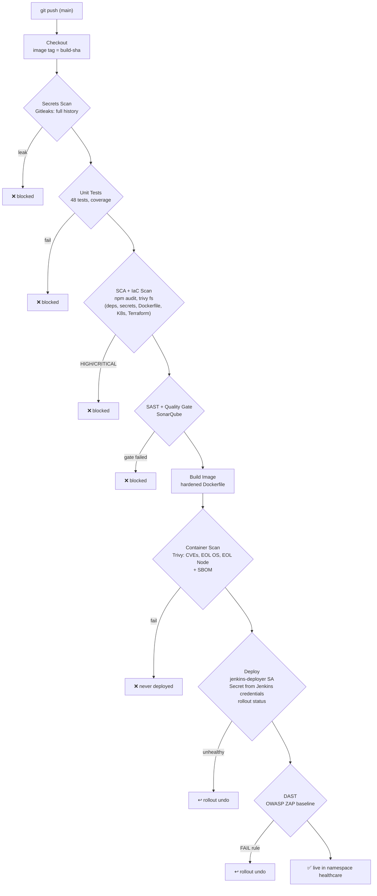
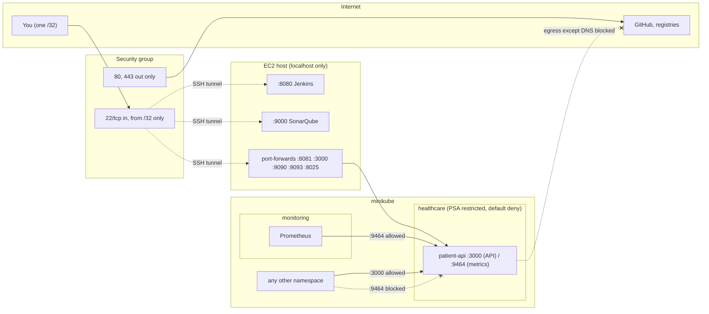

# Architecture

## Pipeline: every stage is a gate

## Runtime: who can talk to whom

## Data protection path for one patient record

1. A receptionist registers a patient: browser → `POST /api/patients` with a Bearer JWT (memory only, 15 min).
2. `authenticate` checks the HS256 signature, issuer, audience, expiry, revocation and the role. `authorize('doctor','receptionist')` checks the role.
3. The zod `strictObject` schema validates every field; unknown fields are rejected.
4. `store.create` encrypts the whole record with AES-256-GCM (random IV, record ID as AAD). Only ciphertext stays in memory.
5. An audit event `{action:create, actor, role, patientId}` is written, and the `phi_records_accessed_total` counter goes up.
6. A later read is decrypted for the response and filtered by role (minimum necessary).

The encryption key exists only in the Kubernetes Secret (encrypted in etcd), which only the pod (as an env var) and the `jenkins-deployer` ServiceAccount can read.
