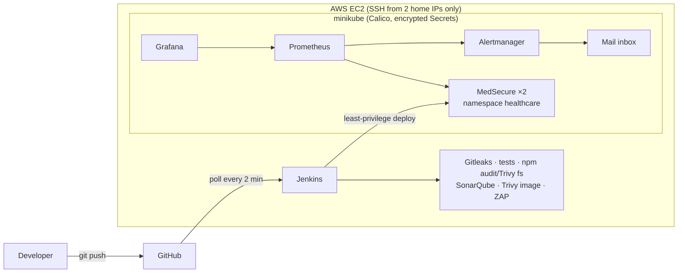

# Virtual Lab Experiment 9: Secure DevSecOps Implementation in Healthcare Systems

| | |
|---|---|
| **Student** | Netra Gupta |
| **Date performed** | 14-15 November 2026 |
| **Platform** | AWS EC2 `m7i-flex.large` (ap-south-1), Ubuntu 24.04, minikube (Kubernetes v1.37) |
| **Repository** | https://github.com/NetraGupta24/vle9-healthcare-devsecops |

---

## 1. Aim

To implement a secure DevSecOps pipeline for a healthcare application, integrating Jenkins (CI/CD), Docker (containerisation), Kubernetes (deployment), SonarQube (static analysis), OWASP ZAP (dynamic testing), Trivy (container scanning) and Prometheus + Grafana (monitoring and alerting).

## 2. Use case

**MedSecure** is a patient-records system for doctors, nurses and receptionists. Its data is Protected Health Information (PHI), which must be:

| Requirement | How it is met |
|---|---|
| **Secure** | role-based access (minimum necessary), JWT authentication, account lockout, rate limiting, input validation, security headers, non-root hardened container, Pod Security "restricted", least-privilege RBAC, network policies |
| **Encrypted** | every patient record encrypted with AES-256-GCM; Kubernetes Secrets encrypted in etcd; encrypted EBS disk; all access through an SSH tunnel |
| **Monitored** | Prometheus metrics for logins, authorisation failures and PHI access; 10 alert rules; Grafana dashboard; email alerts; JSON audit log |
| **Compliant** | controls mapped to the HIPAA Security Rule technical safeguards (access control, audit, integrity, authentication, transmission security), see `docs/SECURITY-CONTROLS.md` |

## 3. Architecture

## 4. Tools and versions used

| Tool | Version | Role |
|---|---|---|
| Terraform | 1.16 / AWS provider 6.x | infrastructure as code (Step 1) |
| Jenkins | 2.580.2 LTS (configured as code) | CI/CD (Step 10) |
| Docker | 29.1 | containerisation (Step 5) |
| minikube / Kubernetes | 1.39.0 / v1.37.0, Calico CNI | deployment (Step 7) |
| SonarQube | 26.11 Community + PostgreSQL 17 | SAST (Step 4) |
| Trivy | 0.76.2 | container + dependency + IaC scanning (Step 6) |
| Gitleaks | 8.30.1 | secrets scanning |
| OWASP ZAP | 2.17.0 | DAST (Step 8) |
| kube-prometheus-stack | 93.3.0 (Prometheus, Alertmanager, Grafana) | monitoring (Step 9) |
| Node.js | 24 LTS | application runtime |

## 5. Procedure and observations

### Step 1: Secure infrastructure (AWS)
Terraform (`infra/terraform/`) run as a dedicated IAM user `vle9-terraform-user`, whose policy only allows EC2 in Mumbai and IAM roles named `vle9-*` (with an explicit Deny on attaching any other policy).
* Security group: inbound **TCP 22 only, from the student's two home IPs (/32)**; outbound only 80/443.
* IAM instance role with one policy (`AmazonSSMManagedInstanceCore`); IMDSv2 required, hop limit 1.
* Encrypted 30 GiB gp3 volume; dedicated VPC; default security group locked.

**Observed:** `Apply complete! Resources: 15 added`. All web UIs reached only through an SSH tunnel.

### Step 2: Install DevSecOps tools
EC2 user data (`scripts/ec2/00-bootstrap.sh`) installed Docker, Git, Java 21, Jenkins, Trivy, kubectl, minikube and Helm (downloads verified by SHA-256) and hardened SSH. SonarQube, ZAP and Gitleaks run as pinned containers.
**Observed:** bootstrap finished in about 3 minutes; `sshd -T` shows `permitrootlogin no`, `passwordauthentication no`.

### Step 3: Secure coding
* Input validation with strict allow-list schemas (unknown fields rejected); `<script>` in a name → HTTP 400.
* No hardcoded secrets: the app refuses to start without `JWT_SECRET`, `PHI_ENCRYPTION_KEY` and the staff passwords, which come from environment variables.
* scrypt password hashing, 15-minute JWTs (HS256 only), lockout after 5 failures, per-IP rate limit, AES-256-GCM per record, audit log.

**Observed:** 49 unit tests pass, 97 % coverage (SonarQube).

### Step 4: SAST (SonarQube)
Pipeline stage `SAST + Quality Gate` runs `sonar-scanner` inside `withSonarQubeEnv` and waits for the Quality Gate.
**Observed:** `QUALITY GATE STATUS: PASSED`, 0 bugs, 0 code smells. During development the gate **failed** on a newly introduced bug (unhandled promise) and passed after the fix.

### Step 5: Secure Docker image
Multi-stage build, `node:24-alpine` pinned by digest, npm/yarn removed, `apk upgrade`, non-root user uid 10001, read-only application files, healthcheck.
**Observed:** `docker run` without secrets → exits with "Missing required environment variable JWT_SECRET" (fails closed).

### Step 6: Container security scan (Trivy)
`trivy image` gate: no fixable HIGH/CRITICAL CVEs, base OS not end-of-life, Node.js ≥ 22; CycloneDX SBOM archived.

| Image | Trivy result | Gate |
|---|---|---|
| Hardened `Dockerfile` | 0 vulnerabilities (any severity), Alpine 3.24.4, Node 24.22.3 | ✅ passed |
| Handout Dockerfile (`node:18-alpine`) | CRITICAL 3, HIGH 43, MEDIUM 55, LOW 38; Alpine 3.21.3 end-of-life | ❌ blocked |
| Jenkins build #5 with `BASE_IMAGE=node:18-alpine` | `FAIL: base OS alpine 3.21.3 is END-OF-LIFE`, `FAIL: Node.js 18.20.8 is end-of-life` | ❌ blocked, never deployed |

### Step 7: Secure Kubernetes deployment
* Namespace `healthcare` enforces Pod Security **restricted**.
* RBAC: Jenkins deploys with ServiceAccount `jenkins-deployer`: it can patch the Deployment and update one Secret, but cannot delete, exec, read other Secrets or change Services/RBAC/NetworkPolicies.
* Secrets are created from Jenkins credentials (never in Git) and **encrypted in etcd** (secretbox).
* NetworkPolicies: default deny; metrics only from `monitoring`; no internet egress.
* Failed rollouts and failed DAST roll back automatically.

**Observed (`scripts/demo/security-checks.sh`): 19 passed, 0 failed**, e.g. privileged pod → `violates PodSecurity "restricted:latest"`; etcd value starts with `k8s:enc:secretbox:v1:key1`; a bad image release was rolled back with no downtime.

### Step 8: DAST (OWASP ZAP)
`zap-baseline.py` against the deployed app; `security/zap/rules.tsv` makes header and information-leak findings FAIL.
**Observed:** `FAIL-NEW: 0, WARN-NEW: 2, PASS: 64`. In development ZAP **found a real flaw**: forms submitted with GET, so the password and patient national ID would end up in URLs if JavaScript failed. Fixed with `method="post"` plus a regression test.

### Step 9: Monitoring and alerting
Prometheus scrapes the app's separate metrics port; Grafana dashboard *MedSecure - Healthcare Security Monitoring*; Alertmanager routes security alerts to `security-team@` and availability alerts to `oncall@` (Mailpit inbox).
**Observed** with `scripts/demo/trigger-alerts.sh`:

| Handout alert | Our alert | Fired |
|---|---|---|
| Unauthorized access | `UnauthorizedAccessSpike` (45 requests without a valid token), `PrivilegeEscalationAttempt` (nurse tried doctor-only actions) | ✅ + email |
| Failed logins | `FailedLoginBurst`, `AccountLockedOut` (30 wrong passwords; HTTP 401 ×18 then 429 ×12) | ✅ + email |
| High CPU usage | `PatientAPIHighCPU` (simulated crypto-miner, 99.85 % of the CPU limit) | ✅ + email |
| (extra) Data exfiltration | `PHIBulkAccess` (80 record reads in a burst) | ✅ + email |
| (extra) Availability | `PatientAPIDown` before the first deploy, RESOLVED after it | ✅ + email |

### Step 10: CI/CD secure pipeline (Jenkins)
`Jenkinsfile`, 9 stages:
Checkout → Secrets Scan (Gitleaks) → Unit Tests → SCA + IaC Scan → SAST + Quality Gate → Build Image → Container Scan (Trivy) → Deploy to Kubernetes → DAST (OWASP ZAP)

**Observed:**

| Build | Trigger | Result |
|---|---|---|
| #1 | manual | ✅ all 9 stages (≈ 3 min) |
| #2, #3, #4, #6 | **started by an SCM change** (git push) | ✅ all 9 stages |
| #5 | manual, `BASE_IMAGE=node:18-alpine` | ❌ blocked at Container Scan; live app unchanged |

Each build archives 13 reports (Gitleaks, JUnit, coverage, npm audit, Trivy, SBOM, ZAP HTML).

## 6. Expected vs. observed output

| Expected (handout) | Observed |
|---|---|
| Secure pipeline execution | 9-stage gated pipeline, green on every commit; ✅ |
| Vulnerabilities detected early | EOL base image, committed secret, new bug and insecure form all stopped before production; 20 problems found and fixed during the build of this project (`docs/VERIFICATION.md`); ✅ |
| Secure container deployment | non-root, read-only, PSA restricted, least-privilege RBAC, encrypted Secrets, network isolation, 19/19 checks; ✅ |
| Monitoring dashboards active | Grafana dashboard live; all security alerts fired and resolved with email notifications; ✅ |

## 7. Screenshots

*(insert from `docs/DEMO.md` checklist)*

1. Terraform apply output and EC2 security group (SSH only)
2. Jenkins stage view: green build (#4 or #6) and blocked build #5
3. SonarQube project dashboard (Quality Gate passed)
4. Trivy report / SBOM artifact
5. OWASP ZAP report (0 FAIL)
6. `security-checks.sh` output (19 PASS)
7. Grafana dashboard during the attack simulation
8. Prometheus alerts firing
9. Mailpit alert emails
10. MedSecure UI: receptionist vs doctor view

## 8. Result

A secure DevSecOps pipeline for a healthcare system was successfully implemented and verified on AWS. Every commit passes six security gates (secrets, dependencies and IaC, SAST, container image, deployment policy, DAST) before and after deployment, and insecure builds are blocked automatically. The application protects PHI with encryption, role-based minimum-necessary access and audit logging; the Kubernetes deployment is non-root, isolated and least-privilege with encrypted secrets; and Prometheus, Grafana and Alertmanager detect and notify on unauthorised access, failed logins, high CPU and bulk data access.

## 9. Conclusion and learning

* Security tools find real problems only when they run on every change **and can fail the build**: ZAP, Trivy, Gitleaks and SonarQube each caught genuine issues in this project.
* Defaults are rarely secure: SonarQube `admin/admin`, base64 "secrets", an end-of-life base image, Kubernetes allowing root pods and open networking all had to be changed.
* Different scanners see different things (Trivy could not see the end-of-life Node.js binary; only DAST found the GET forms), so layers are needed.
* Monitoring must be tested with simulated attacks: one alert (bulk PHI access) only worked after a metrics bug found during that test was fixed.

**Production next steps:** EKS with private nodes, managed encrypted database (RDS + KMS), TLS ingress, AWS Secrets Manager, signed images with admission control, separate staging environment, centralised logging/SIEM.
